<div align="center">


# Kausa — Know why your numbers moved.

[](https://github.com/opeblow/KAUSA/actions/workflows/ci.yml)
[](https://github.com/opeblow/KAUSA/actions/workflows/deploy-convex.yml)


</div>

An investigative agent for business metrics. Upload a CSV or Excel export, ask *"Why did sales drop in
September?"*, and Kausa measures the gap against a weekday baseline, attributes it across your numeric
driver columns, and reports what the evidence supports — with every figure linked to its query, rows and
calculation.

This repository is the **web application and backend** for Kausa, built to the screen specifications in
the product PRD (`../Kausa_PRD.docx`, Sections 13 and 14) with the component language of
[Aceternity UI](https://ui.aceternity.com/components) and [Magic UI](https://magicui.design/docs/components).

> **How it works (read this).** All numbers are computed in code over *your* uploaded data — a weekday
> seasonal-naive baseline for the expected value, a 90% interval from the comparison-window residual, and
> an OLS regression over your driver columns for attribution, with an explicit unexplained remainder. The
> language model only writes prose about those computed numbers — NVIDIA Nemotron via NIM by default, with
> SpaceXAI Grok and the Meterless Runtime as drop-in backends behind the same interface. A runtime verifier
> checks every number in the narrative against the claim ledger and falls back to a deterministic template
> on any mismatch. When Zetaris is configured, the analysis slice is read by **federated SQL through the
> Zetaris AI Data Harness** rather than only the local store. Results are **evidence-weighted explanations,
> not proof of causation**.

---

## Table of contents

- [What's implemented](#whats-implemented)
- [Architecture](#architecture)
  - [Backend surface (`convex/`)](#backend-surface-convex)
- [Design language](#design-language)
- [Tech stack](#tech-stack)
- [Sponsors](#sponsors)
- [Getting started](#getting-started)
- [Screenshots](#screenshots)
- [Project structure](#project-structure)
- [Privacy & security](#privacy--security)
- [Honesty and limits](#honesty-and-limits)

---

## What's implemented

| Screen (PRD §14) | Route | Highlights |
| --- | --- | --- |
| Landing | `/` | Aurora + spotlight + meteors hero, number tickers, proof section, real-stack marquee |
| Sign in / up | `/signin` | Convex Auth (password), private per-account workspace |
| Workspace & data sources | `/app/workspace` | Upload CSV/TSV/Excel, parsing status, row counts, schema roles, data-quality report |
| Overview | `/app/overview` | Headline metric + gap, actual-vs-expected chart with interval band, driver ranking |
| Ask | `/app/ask` | Placeholder-cycling input, real dataset picker, editable scope (dimension + date windows) |
| Live investigation | `/app/investigation` | Plan, hypothesis rows, agent graph, live run log, cancel |
| Verdict | `/app/verdict` | Contribution waterfall, ranked causes with confidence, "What we ruled out", recommendations, limitations |
| Evidence panel | any `?claim=` | Query, row sample, calculation steps, model/data/code provenance, verifier result |
| Missions | `/app/missions` | Saved investigations, detail, rename, re-run, delete |
| Methodology | `/app/methodology` | Approach, verification, limits, data handling, glossary |
| Error states | `*` | 404 / 500 / offline / 429 / maintenance, each with request ID and recovery |

Every figure in the verdict is clickable and deep-links its evidence (`?claim=C-0004`).

## Architecture

- **Convex** — one reactive, type-safe backend: database, file storage, auth, scheduled/background work
  and realtime updates in a single deploy. Schema and functions live in `convex/`.
- **Deterministic statistics** (`convex/lib/stats.ts`) — weekday baseline, gap + interval, OLS attribution,
  remainder. The model never calculates.
- **Zetaris AI Data Harness** (`convex/lib/zetaris.ts`) — optional SQL federation. When configured, Kausa
  runs its per-day aggregate slice query (`run-query` REST API, bearer auth) *where the data lives* and
  reads back the result; otherwise it reads the local store. Both paths aggregate identically (per-day
  `SUM` of the metric, `AVG` of drivers).
- **Swappable narration** (`convex/lib/llm.ts`) — one OpenAI-compatible interface over **NVIDIA Nemotron
  (NIM)**, **SpaceXAI Grok** and the **Meterless Runtime**. Kausa tries the first configured provider, then
  the next on failure, then a deterministic template; the provider that wrote the verdict is recorded. It
  receives compact computed summaries only (never raw rows), and a verifier reconciles each number against
  the claim ledger (`passed` | `repaired` | `fallback`).
- **Durable memory** (`convex/lib/hmem.ts`, `convex/memories.ts`) — a Convex-native port of Meterless's
  **H-MEM** engine. Each investigation mines reusable facts and the next one recalls the most relevant,
  ranked by a hybrid of semantic, keyword, tag, domain, entity, layer and recency signals, with supersede
  handling, feedback deltas and an append-only trust ledger.

### Backend surface (`convex/`)

- `datasets.ts` — `list`, `get`, `dimensions`, `generateUploadUrl`, `claimUpload`, `create`, `retryParse`, `remove`.
- `parseDataset.ts` (`internalAction`) — parses the uploaded file, infers column roles, writes schema + rows.
- `investigations.ts` — `create`, `get`, `list`, `claimsFor`, `setSaved`, `remove`, `cancel`.
- `runInvestigation.ts` (`internalAction`) — federated/local read → baseline → gap → attribution → memory recall → narration → memory mining → claims.
- `memories.ts` — H-MEM durable memory: `list`, `ledger`, `remember`, `feedback`, `forget` (public) and `_recall`/`_noteRecalls`/`mine`/`_insertMany` (internal).
- `users.ts` — `current` (email/name for the shell).
- `auth.ts`, `http.ts`, `schema.ts` — auth config and HTTP routes (`GET /health`).

## Design language

The visual system comes from the two component libraries, restyled to Kausa's restrained dark surface.
Components adapted in `src/components/ui/`:

- **Aceternity UI** — Aurora Background, Spotlight, Meteors, Text Generate Effect, Lamp, Card Spotlight,
  Timeline (scroll beam), Grid/Dot backgrounds, Placeholders-and-Vanish input, Bento Grid, Moving Border.
- **Magic UI** — Animated Beam (agent graph), Border Beam & Shine Border, Magic Card, Blur Fade, Number
  Ticker, Animated List, Marquee, Animated Shiny Text.

Design tokens live in `tailwind.config.js` and `src/index.css` (near-black base `#05060a`, indigo/cyan
accent, `Inter` + `JetBrains Mono`).

## Tech stack

- React 18 + TypeScript (strict) + Vite 5
- Convex 1.x — database, functions, file storage, auth (`@convex-dev/auth`, password provider)
- Narration through one OpenAI-compatible interface: **NVIDIA Nemotron (NIM)**, **SpaceXAI Grok**,
  **Meterless Runtime** — called from a Convex action, provider swappable by env
- **Zetaris** SQL federation (`run-query` REST API) for the data-read step when configured
- `papaparse` + `xlsx` for CSV/TSV/Excel parsing
- Tailwind CSS 3 + `tailwindcss-animate`, Framer Motion, React Router 6, lucide-react
- Hand-rolled SVG charts (no charting dependency) for the waterfall and actual-vs-expected

## Sponsors

Kausa integrates four hackathon sponsors for real, each with a distinct job:

| Sponsor | Role | Wired in | Env |
| --- | --- | --- | --- |
| **Zetaris** | Federated SQL data harness — reads the analysis slice where the data lives | `convex/lib/zetaris.ts`, `runInvestigation.ts` | `ZETARIS_BASE_URL`, `ZETARIS_ORG_ID`, `ZETARIS_API_KEY` (or user/pass), `ZETARIS_SOURCE` |
| **NVIDIA** | Default narrator — Nemotron via NIM writes the verdict prose | `convex/lib/llm.ts` | `NVIDIA_API_KEY`, `NVIDIA_MODEL`, `NVIDIA_BASE_URL` |
| **SpaceXAI** | Alternate narrator — Grok behind the same interface | `convex/lib/llm.ts` | `SPACEXAI_API_KEY`, `SPACEXAI_MODEL`, `SPACEXAI_BASE_URL` |
| **Meterless** | Durable memory — the **H-MEM** memory engine, ported to Convex: mines reusable facts from each investigation and recalls the relevant ones into the next | `convex/lib/hmem.ts`, `convex/memories.ts`, `runInvestigation.ts`, `src/pages/Memory.tsx` | none (pure engine; uses the configured narrator for extraction) |

The Meterless integration is the **H-MEM engine**, not the Nightshift runtime: the same eight-signal hybrid
ranker (semantic, keyword, tag, domain, entity, layer, recency, supersede penalty), trust ledger, feedback
deltas and reinjection format from the reference engine, with embeddings computed deterministically in code
and storage in Convex. Recalled context is digit-stripped before it reaches the narrator, so memory can never
introduce a number that is not in the claim ledger.

Every adapter is env-gated with a graceful fallback: without keys, Kausa still runs end-to-end on the
deterministic template and the local store. `LLM_PROVIDER` forces a specific narrator; otherwise the first
configured provider wins, then the next, then the template. The provider that wrote a verdict is shown on
the investigation (`model`) and in the run log.

## Getting started

```bash
npm install
npx convex dev          # link/create the deployment; regenerates convex/_generated
npm run dev             # http://localhost:5173
```

Auth keys are generated and set on the deployment (no Clerk/Auth0 account needed). Narration and data
adapters are all optional — set whichever sponsors you have (see `.env.example` for the full list):

```bash
# set JWT_PRIVATE_KEY, JWKS and SITE_URL, then optionally:

# Narrator — at least one is optional (without any, narration uses the template fallback)
npx convex env set NVIDIA_API_KEY <key>
npx convex env set NVIDIA_MODEL nvidia/nemotron-3-super-120b-a12b
npx convex env set NVIDIA_BASE_URL https://integrate.api.nvidia.com/v1

npx convex env set SPACEXAI_API_KEY <key>        # SpaceXAI Grok
npx convex env set METERLESS_API_KEY <key>       # Meterless Runtime
npx convex env set LLM_PROVIDER nvidia           # optional: force a provider

# Zetaris federated SQL (optional)
npx convex env set ZETARIS_BASE_URL https://api.saas.enterprise.zetaris.com
npx convex env set ZETARIS_ORG_ID <org-id>
npx convex env set ZETARIS_API_KEY <key>         # or ZETARIS_USERNAME / ZETARIS_PASSWORD
npx convex env set ZETARIS_SOURCE kausa.retail_sales
```

`.env.local` (repo root) holds the client config:

```
VITE_CONVEX_URL=https://<deployment>.convex.cloud
VITE_CONVEX_SITE_URL=https://<deployment>.convex.site
```

Other scripts:

```bash
npm run build      # tsc -b && vite build
npm run preview    # serve the production build
npm run typecheck  # tsc -b --noEmit
```

Browser smoke tests (need a local Chrome; start `npm run preview` first):

```bash
node scripts/smoke.mjs    # every route renders, zero console/page errors
node scripts/flow.mjs     # run a full investigation → verdict → evidence → cancel
node scripts/layout.mjs   # horizontal-overflow and computed-style checks
node scripts/shots.mjs    # regenerate docs/screenshots/*.png
```

## Screenshots

| | |
| --- | --- |
| 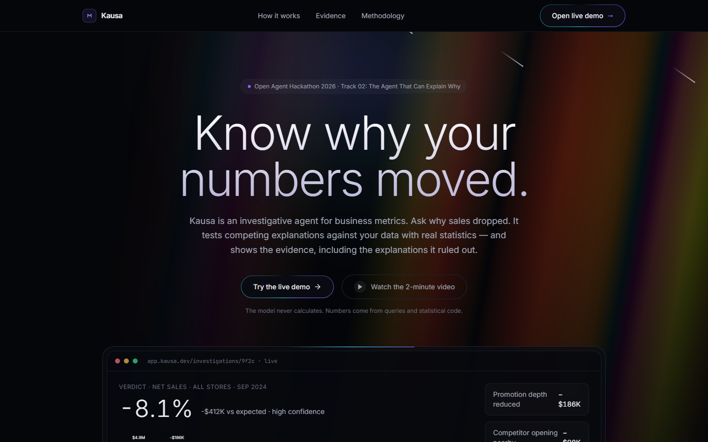 | 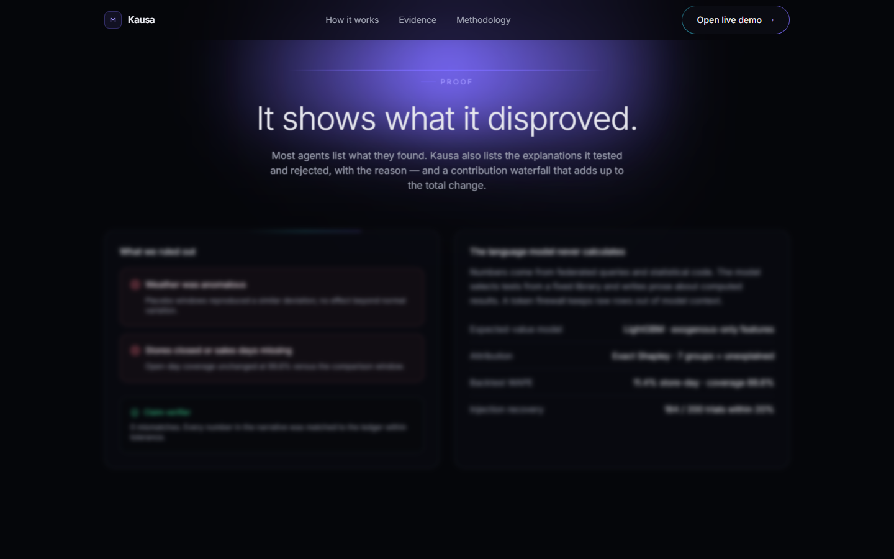 |
| 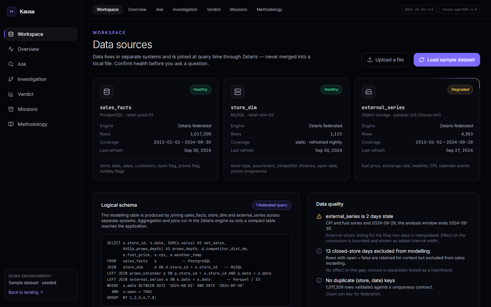 | 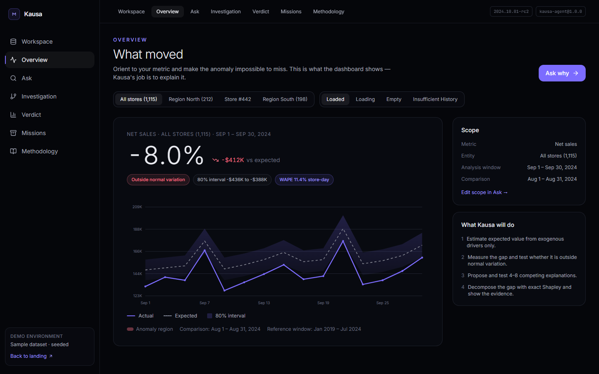 |
| 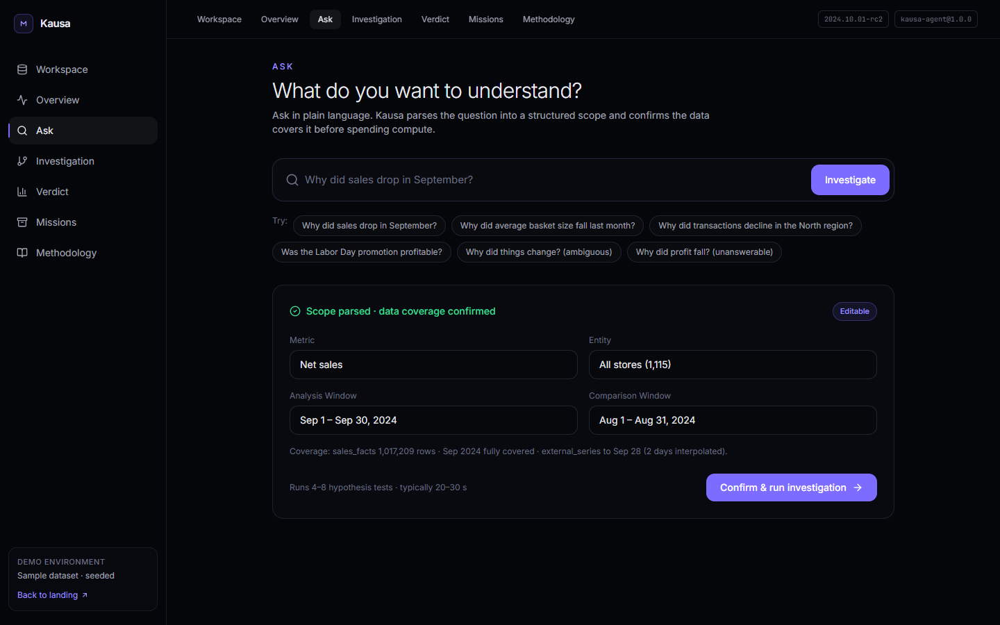 | 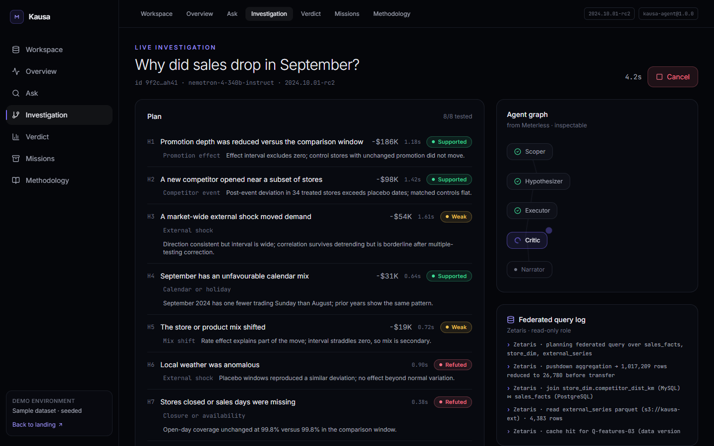 |
| 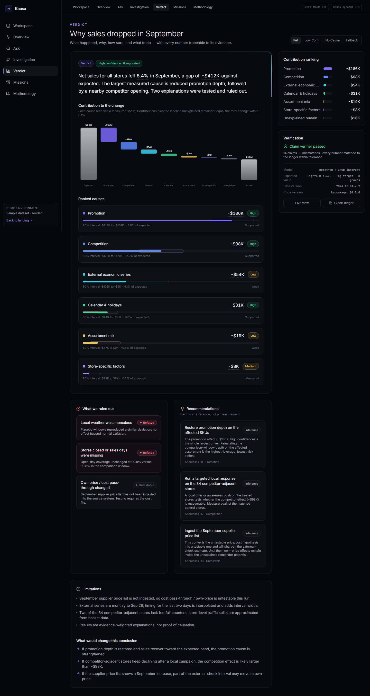 | 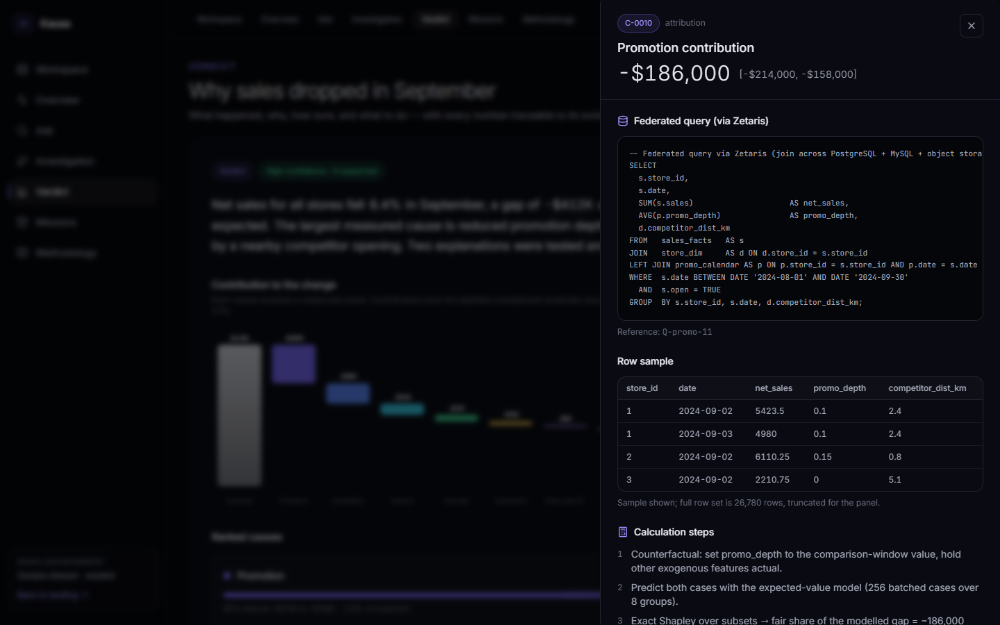 |
| 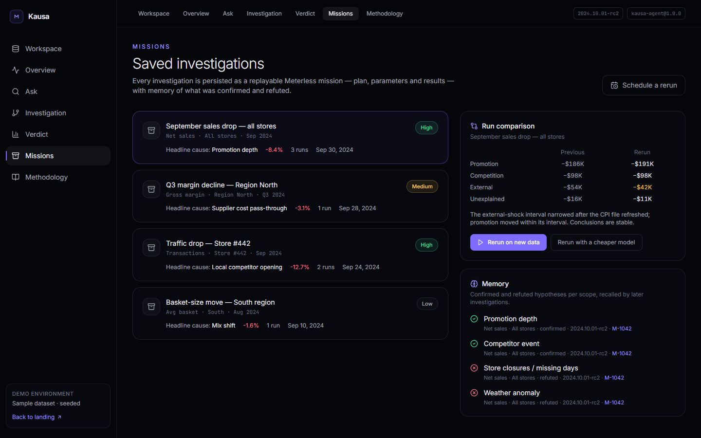 | 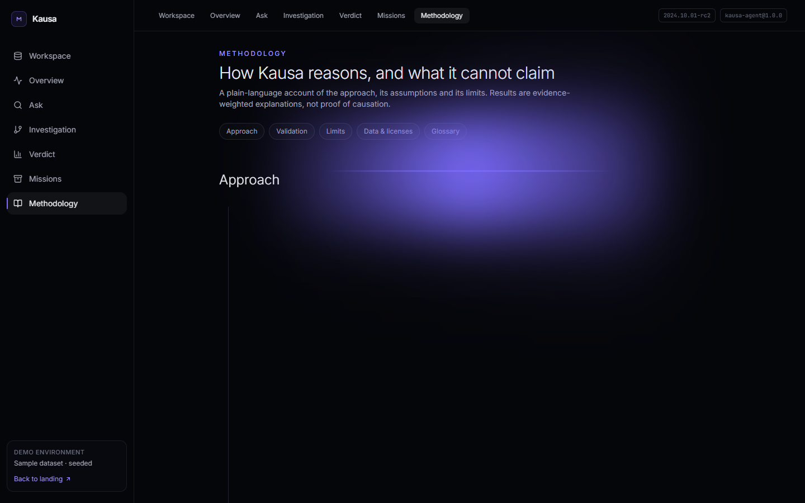 |
| 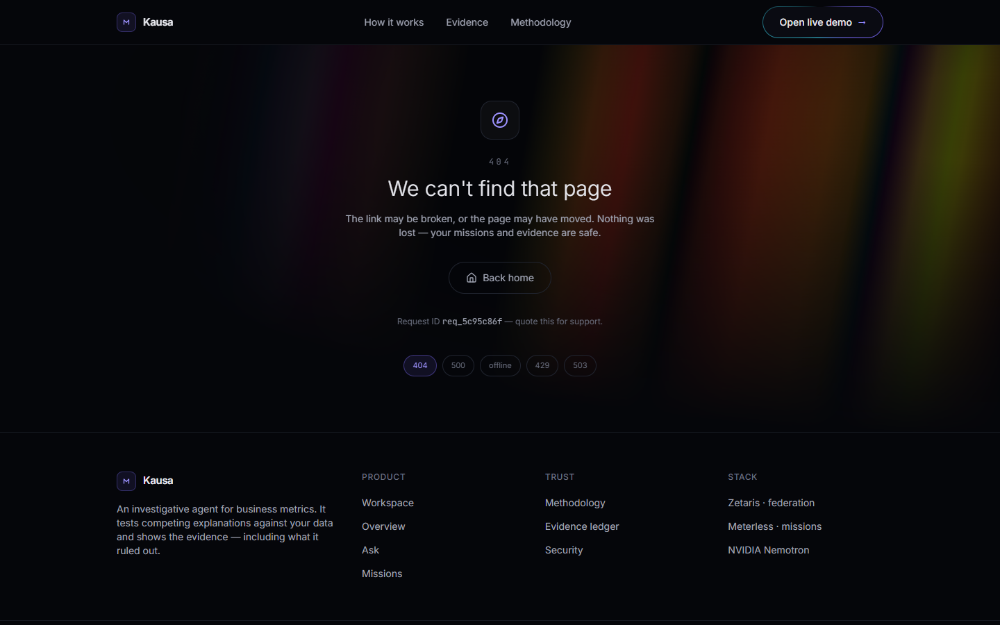 | 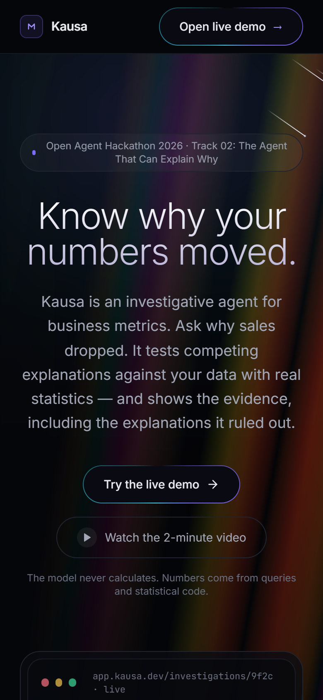 |

## Project structure

```
kausa/
├── .github/
│   └── workflows/
│       ├── ci.yml                     # Typecheck + build on every push and PR
│       └── deploy-convex.yml          # Deploy backend to production on push to main
├── .devcontainer/
│   ├── devcontainer.json              # Codespaces / dev container definition
│   ├── start-zetaris.sh               # Starts the local Zetaris stack
│   └── .env.example
├── convex/                            # Backend (Convex)
│   ├── _generated/                    # Generated by Convex — do not edit
│   ├── lib/
│   │   ├── hmem.ts                    # H-MEM ranking, embedding, mining helpers
│   │   ├── llm.ts                     # Provider-agnostic narration + number verifier
│   │   ├── parse.ts                   # Column detection + per-day aggregation
│   │   ├── stats.ts                   # Baseline, gap interval, OLS attribution
│   │   └── zetaris.ts                 # Zetaris federated SQL client
│   ├── auth.config.ts
│   ├── auth.ts                        # Convex Auth (password)
│   ├── datasets.ts                    # Upload, list, parse state, point storage
│   ├── http.ts                        # Auth routes + GET /health
│   ├── investigations.ts              # Investigation lifecycle + claims
│   ├── memories.ts                    # H-MEM durable memory
│   ├── parseDataset.ts                # CSV / Excel parsing action
│   ├── runInvestigation.ts            # End-to-end investigation runner
│   ├── schema.ts                      # Database schema
│   ├── users.ts
│   └── tsconfig.json
├── docs/
│   └── screenshots/                   # Generated by scripts/shots.mjs
├── public/
│   ├── _redirects                     # SPA fallback (Cloudflare Pages / Netlify)
│   └── favicon.svg
├── scripts/
│   ├── flow.mjs                       # End-to-end flow (puppeteer-core)
│   ├── layout.mjs                     # Layout checks
│   ├── setup-prod.mjs                 # One-time production Convex setup
│   ├── shots.mjs                      # Screenshot capture
│   └── smoke.mjs                      # Smoke test
├── src/                               # Frontend (React + Vite)
│   ├── components/
│   │   ├── layout/
│   │   │   ├── AmbientBackdrop.tsx
│   │   │   ├── AppShell.tsx
│   │   │   ├── Footer.tsx
│   │   │   └── SiteNav.tsx
│   │   ├── ui/                        # Aceternity / Magic UI primitives
│   │   ├── Brand.tsx
│   │   ├── charts.tsx                 # ActualVsExpected, Waterfall, ContributionRanking
│   │   ├── EvidencePanel.tsx
│   │   ├── PageHeader.tsx
│   │   └── StatusPill.tsx
│   ├── data/
│   │   └── kausa.ts                   # Shared types + glossary
│   ├── lib/
│   │   ├── api.ts                     # Generated API re-exports
│   │   ├── convex.ts                  # Convex client
│   │   └── utils.ts                   # Formatting helpers
│   ├── pages/
│   │   ├── Ask.tsx
│   │   ├── ErrorScreen.tsx
│   │   ├── Investigation.tsx
│   │   ├── Landing.tsx
│   │   ├── Memory.tsx
│   │   ├── Methodology.tsx
│   │   ├── Missions.tsx
│   │   ├── Overview.tsx
│   │   ├── SignIn.tsx
│   │   ├── Verdict.tsx
│   │   └── Workspace.tsx
│   ├── store/
│   │   ├── evidence.tsx               # Evidence panel state (?claim=)
│   │   └── investigation.tsx          # Live investigation state (?i=)
│   ├── App.tsx
│   ├── index.css
│   ├── main.tsx
│   └── vite-env.d.ts
├── .env.example                       # Environment variable reference
├── .gitignore
├── index.html
├── package.json
├── postcss.config.js
├── remotion.config.ts
├── tailwind.config.js
├── tsconfig.json
├── tsconfig.app.json
├── tsconfig.node.json
├── vercel.json
└── vite.config.ts
```

## Privacy & security

- **Per-account isolation.** Every dataset, investigation and claim is owned by the user who created it.
  Each public query/mutation resolves the caller from the verified auth token (`getAuthUserId`) and checks
  ownership server-side before reading or writing — unauthenticated calls are rejected, and another user's
  id returns nothing (no existence oracle, no cross-account reads).
- **What leaves the deployment.** Narration calls exactly one third party — whichever sponsor provider is
  configured (NVIDIA NIM, SpaceXAI or Meterless) — and sends *computed aggregates*: metric name, dimension
  labels, the window, driver contributions. Never raw rows. If Zetaris is configured, the aggregate slice
  query is sent to the Zetaris deployment (this is the intended federated read; it returns aggregated days,
  not your file). With no provider key and no Zetaris config, no external call is made.
- **Uploads.** Files sit in Convex file storage scoped to the owner, capped at **25 MB**, parsed in an
  internal action, and aggregated to per-day points (≤ 200k rows, ≤ 60k points, ≤ 40 distinct
  values/dimension). A dataset can only be created from a storage blob the same account claimed via
  `datasets.claimUpload`, and the claim is consumed on creation.
- **Deletion.** Removing a dataset or investigation purges its stored file and *all* child rows in
  scheduled batches, so deleted data does not linger.
- **Abuse limits.** Uploads and investigations are rate-limited per account (15 uploads / 10 runs per 5 min).
- **Secrets.** Provider keys, `ZETARIS_*`, `JWT_PRIVATE_KEY` and `JWKS` live only in the Convex deployment
  env vars, never in the client bundle. `.env` / `.env.local` are git-ignored (`!.env.example` is committed).

> When (re)setting `JWT_PRIVATE_KEY` / `JWKS`, avoid a trailing `\r` — piping from PowerShell adds one.
> Verify with `npx convex env list` (it warns if a value carries a carriage return).

## Honesty and limits

- All figures in a verdict are computed over your uploaded data on the Convex deployment and stored as
  claims with their query, rows and calculation. The Landing page's verdict preview is the one labelled
  illustrative example; everything in the app is live.
- The language model never calculates and never sees raw rows — only compact computed summaries. Every
  number it writes is verified against the claim ledger.
- Results are **evidence-weighted explanations, not proof of causation** — the Methodology screen states
  the assumptions and failure modes.
- Without `NVIDIA_API_KEY`, the deterministic template narrator is used (real compute, no LLM prose).
